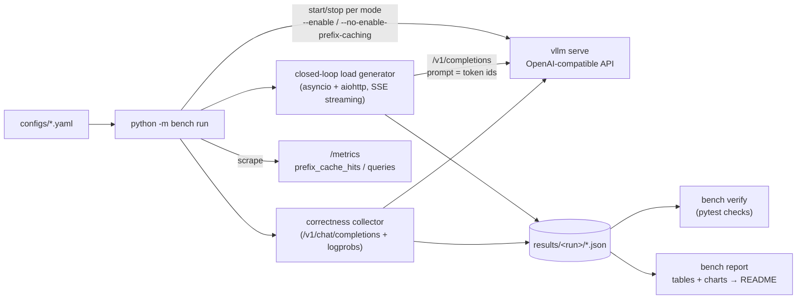

# vllm-serving-bench

A small, complete experiment around serving an open-source LLM with **vLLM**: run the server,
load it with concurrent traffic, measure it, and verify it still gives correct answers.
It is built around three questions:

| | Question | What this repo does |
|---|---|---|
| 1 | **How does the service run?** | Launches `vllm serve` (OpenAI-compatible API), manages its lifecycle, and drives it with an async closed-loop load generator over streamed `/v1/completions`. |
| 2 | **How is performance verified?** | Fixed model and fixed input/output lengths, swept across concurrency levels; a shared-prefix workload A/B-tests **prefix caching on vs. off**. Reports **TTFT**, **P95 end-to-end latency** and **output tokens/s**, plus prefix-cache hit rate scraped from `/metrics`. |
| 3 | **How is correctness verified?** | Re-runnable pytest checks: fixed-prompt determinism, batched-vs-sequential agreement, cache on/off and cold/warm agreement, long-context needle retrieval, over-length rejection, streaming API contract, and a golden-output regression snapshot. |



---

## Results

<!-- RESULTS:START -->
> **No GPU results committed yet.** This section is generated by `python -m bench report` from
> the JSON of a real run (see [Run it on a GPU](#run-it-on-a-gpu)); nothing here is typed by hand.
> CI exercises the same pipeline against a mock server, but mock numbers are synthetic and are
> deliberately not committed.
<!-- RESULTS:END -->

---

## Run it on a GPU

Reference setup: one 24 GB GPU (NVIDIA L4 or A10G — e.g. a cloud VM or Colab with an L4),
`Qwen/Qwen2.5-1.5B-Instruct`, `max_model_len=8192`. Both modes together take roughly 30–45 minutes.

```bash
git clone https://github.com/lexiegao3-cyber/lexiegao3-cyber-vllm-serving-bench.git
cd lexiegao3-cyber-vllm-serving-bench
python -m venv .venv && source .venv/bin/activate
pip install vllm -r requirements.txt

make all          # = bench + verify + report
# or step by step:
python -m bench run    --config configs/l4_qwen2.5-1.5b.yaml --out results/l4-qwen2.5-1.5b
python -m bench verify --results results/l4-qwen2.5-1.5b          # correctness checks
python -m bench report --results results/l4-qwen2.5-1.5b --readme README.md
pytest tests/correctness --results results/l4-qwen2.5-1.5b --update-golden   # first run only: snapshot outputs
git add results/l4-qwen2.5-1.5b golden README.md && git commit -m "results: L4 / Qwen2.5-1.5B"
```

`bench run` starts the server itself (once with `--enable-prefix-caching`, once with
`--no-enable-prefix-caching`), waits for `/health`, runs everything, and shuts it down so the
GPU is free for the next mode. Each results directory also stores `config.json`, `env.json`
(GPU, driver, vLLM/torch versions, git commit) and the server logs, so a run can be reproduced.

Other entry points:

```bash
# serve manually and point the load generator at it (Q1 in isolation)
vllm serve Qwen/Qwen2.5-1.5B-Instruct --max-model-len 8192 --seed 0
python -m bench load --model Qwen/Qwen2.5-1.5B-Instruct -c 16 -n 128 --input-len 1024 --output-len 128
python -m bench load --model Qwen/Qwen2.5-1.5B-Instruct --request-rate 4    # open-loop Poisson arrivals

# whole pipeline without a GPU (mock server) -- what CI runs
make mock
```

---

## Methodology

### Metrics (all measured client-side, `time.perf_counter`)

| Metric | Definition |
|---|---|
| **TTFT** | request sent → first streamed chunk containing text. Dominated by queueing + prefill. |
| **E2E latency** (P50/P95/P99) | request sent → end of stream. |
| **TPOT** | (E2E − TTFT) / (output_tokens − 1): per-request decode speed. |
| **Output tokens/s** | total generated tokens / wall time of the measured phase: system throughput. |
| **Prefix-cache hit rate** | Δ`prefix_cache_hits` / Δ`prefix_cache_queries` (tokens), scraped from vLLM's Prometheus `/metrics` before/after each level. |

Token counts come from the server's `usage` block (`stream_options.include_usage`), not from
counting SSE chunks — one chunk can carry several tokens.

### Controls that keep the comparison fair

- **Exact lengths.** Prompts are sent as **token-id lists**, so every request has exactly
  `input_len` tokens (no re-tokenization drift). Output is pinned with `ignore_eos=true` +
  `max_tokens`, so every request does the same decode work. The report checks
  `output_len_exact` per level.
- **Natural-looking tokens.** Ids are windows of a tokenized, seeded filler corpus rather than
  random vocab ids, so the model sees text-like input.
- **Closed loop.** Exactly *c* requests are in flight at all times, so *c* is the batch size the
  scheduler sees; `n = max(32, 4c)` requests per level, plus warm-up requests excluded from stats.
- **Greedy decoding**, `--seed 0`, the same prompts (seeded) in both modes.
- **Prefix caching set explicitly in both modes.** Recent vLLM versions enable it by default,
  so the "off" run passes `--no-enable-prefix-caching` rather than assuming.
- **Fresh prefixes per concurrency level** in the shared-prefix workload, so a level never
  benefits from blocks cached by the previous one: each of the 4 prefix groups pays exactly one
  cold miss per level.
- **No-reuse control.** The random-prompt sweep runs in both modes too: with nothing shared, cache
  on vs. off should look the same, which isolates the effect of reuse from any bookkeeping overhead.

### Correctness checks (`tests/correctness/`)

The run only *records* evidence (outputs, top-2 logprobs, status codes, cache counters) to JSON;
the pass/fail logic is plain pytest over that JSON, so checks can be re-run or tightened without
the GPU.

**Agreement rule.** Greedy decoding is not guaranteed to be bit-identical across batch
compositions or kernel paths (cache hit vs. full prefill): floating-point reductions are not
associative, so logits can differ in the last bits, which only flips the argmax when the top-2
tokens are nearly tied. Two outputs therefore *agree* if they are identical **or** first diverge
at a token whose top-1/top-2 logprob gap is below `near_tie_nats` (0.5). A divergence at a
confident position is treated as a bug.

| Check | What it would catch |
|---|---|
| `fixed_prompts_repeat_identically` | non-determinism with identical batch shape (exact match required) |
| `batched_matches_sequential` | batching / scheduling changing results |
| `fixed_prompts_cache_on_vs_off`, `shared_prefix_cache_on_vs_off` | prefix caching changing what the model says |
| `warm_hit_matches_cold_miss` | KV blocks reused for the wrong prefix (stale / mis-hashed cache) |
| `prefix_cache_is_actually_hit` / `_is_off_when_disabled` | an A/B that silently compares the same configuration twice |
| `long_context_requests_accepted` | silent truncation of long prompts |
| `needle_retrieval` (3 lengths × 3 depths, up to 0.9 × `max_model_len`) | broken long-context attention / positional handling |
| `needle_results_same_with_and_without_cache` | long-context behaviour depending on the cache |
| `overlong_prompt_rejected_cleanly` | over-length prompt not returning HTTP 400, or taking the server down |
| `streaming_contract` | malformed SSE, wrong `usage`, `max_tokens` not honoured, wrong `finish_reason` |
| `matches_golden` | output regressions after a vLLM upgrade or flag change (snapshot in `golden/`) |

**Testing the tests.** The mock server has a `--inject-cache-bug` mode in which a request that
hits the prefix cache only "sees" the cached prefix — as if stale KV blocks were reused. CI
runs the suite against it and **requires** `warm_hit_matches_cold_miss` and
`shared_prefix_cache_on_vs_off` to fail; if they pass, CI fails.

---

## Repository layout

```
bench/
  client.py        streaming OpenAI-compatible client (TTFT / ITL / usage), /tokenize, /metrics scrape
  loadgen.py       closed-loop (fixed concurrency) and open-loop (Poisson) load generation
  workloads.py     exact-length token-id prompts; shared-prefix workload
  metrics.py       percentiles, throughput, TPOT
  server.py        launch / health-check / graceful stop of the server per mode
  experiment.py    the full experiment: throughput sweep, prefix A/B, correctness collection
  correctness.py   records correctness evidence from a live server
  compare.py       greedy-output agreement rule (exact or near-tie divergence)
  report.py        markdown tables + charts, README splice
configs/           l4_qwen2.5-1.5b.yaml (real run), mock.yaml, mock_buggy_cache.yaml (CI)
tests/unit/        pure-Python tests (no server)
tests/correctness/ checks over recorded evidence
tools/mock_server.py  CI-only mock of the vLLM API (synthetic timings, fault injection)
golden/            output snapshots for regression checks
results/<run>/     JSON, charts, summary.md, env.json, server logs of each real run
```

## Limitations and next steps

- Single GPU, one small model; results are specific to the hardware and vLLM version recorded in `env.json`.
- Closed-loop load measures latency at a fixed batch size; for SLO-style "max request rate under a
  P95 target" use the open-loop mode (`bench load --request-rate`) and sweep the rate.
- Next experiments that fit the same harness: speculative decoding (`--speculative-config`),
  chunked-prefill size, and structured output / tool-calling accuracy under load.
